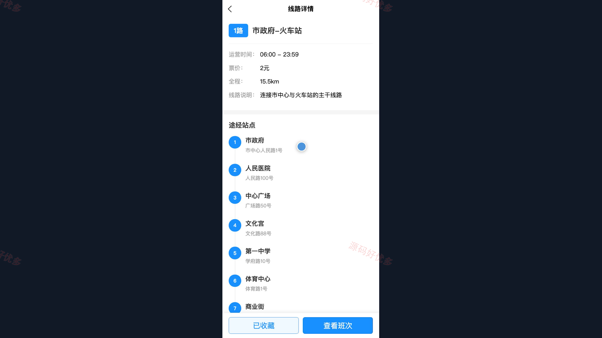
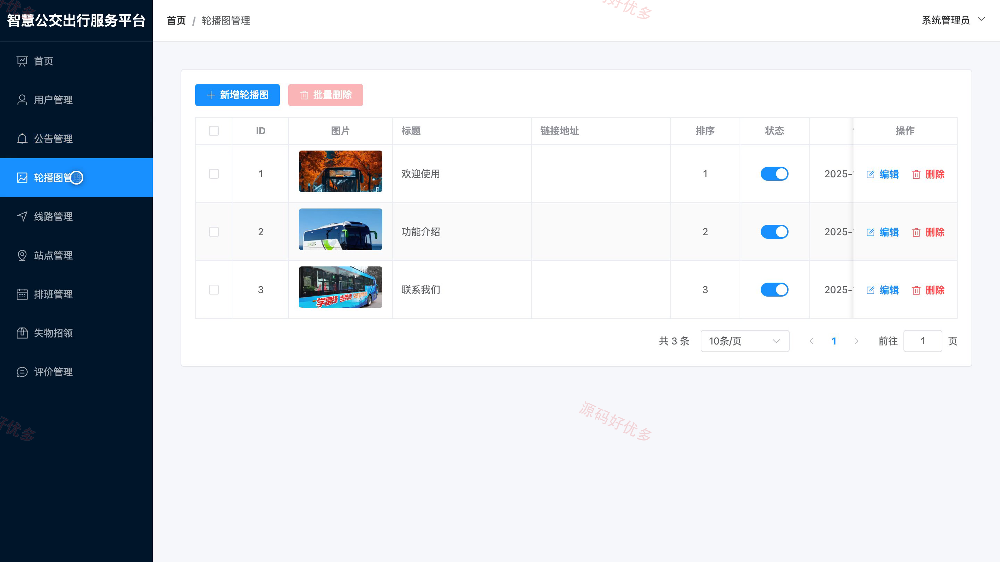
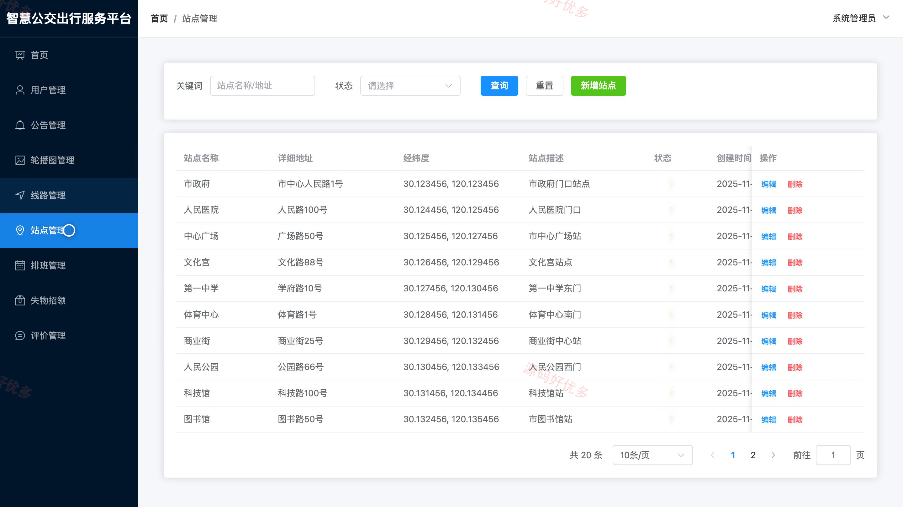

# bs141B
bs141B智慧公交出行服务小程序源码 Java SpringBoot3 Vue3 前后分离
## 源码问题查看主页咨询

### 一、关键词
智慧公交、公交线路查询、实时到站、公交出行、失物招领

### 二、作品包含
源码+数据库+万字设计文档+PPT+全套环境和工具资源+本地部署教程

### 三、项目技术
前端技术： Html、Css、Js、Vue3.4、Element-Plus、uniapp
后端技术：Java、SpringBoot3.2.0、MyBatis-Plus

### 四、运行环境要求
开发工具：IDEA/eclipse + VSCODE + HBuilder X + 微信开发者工具

数据库：MySQL5.7+（共12张表）

数据库管理工具：Navicat10以上版本

环境配置软件： JDK17 + Maven3.6

前端Nodejs：20

浏览器：谷歌浏览器

### 五、项目介绍
项目编号：bs141B

智慧公交出行服务小程序提供公交线路与站点查询、班次和实时到站信息，并支持线路收藏、失物招领及乘车反馈。司机可查看班次并更新位置；管理员维护线路、站点、排班、公告和用户资料，处理失物招领及反馈。

角色：用户、司机、管理员

用户功能：注册登录与个人资料维护、按起终点查询公交线路、查看线路站点和运营时间、查询班次与实时到站、收藏常用线路、发布与查看失物招领、提交乘车评价反馈、查看公告并修改密码。

司机功能：登录司机服务页面、查看本人班次安排、更新车辆当前位置、查看乘客反馈、登记失物招领。

管理员功能：用户和司机账号管理、公交线路与站点维护、车辆及司机排班管理、失物招领审核、评价反馈查看与回复、轮播图和公告管理、公交业务数据统计。

### 六、运行截图

